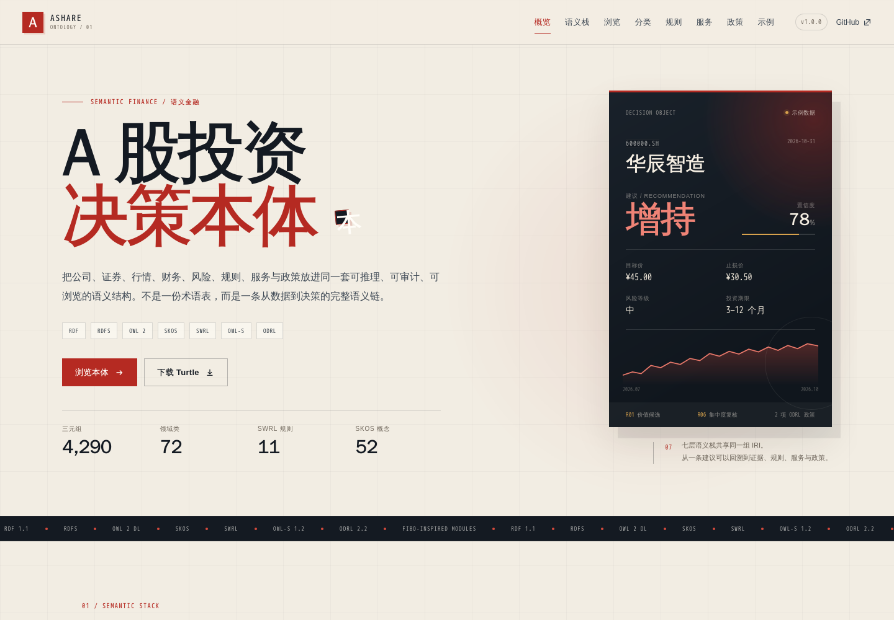
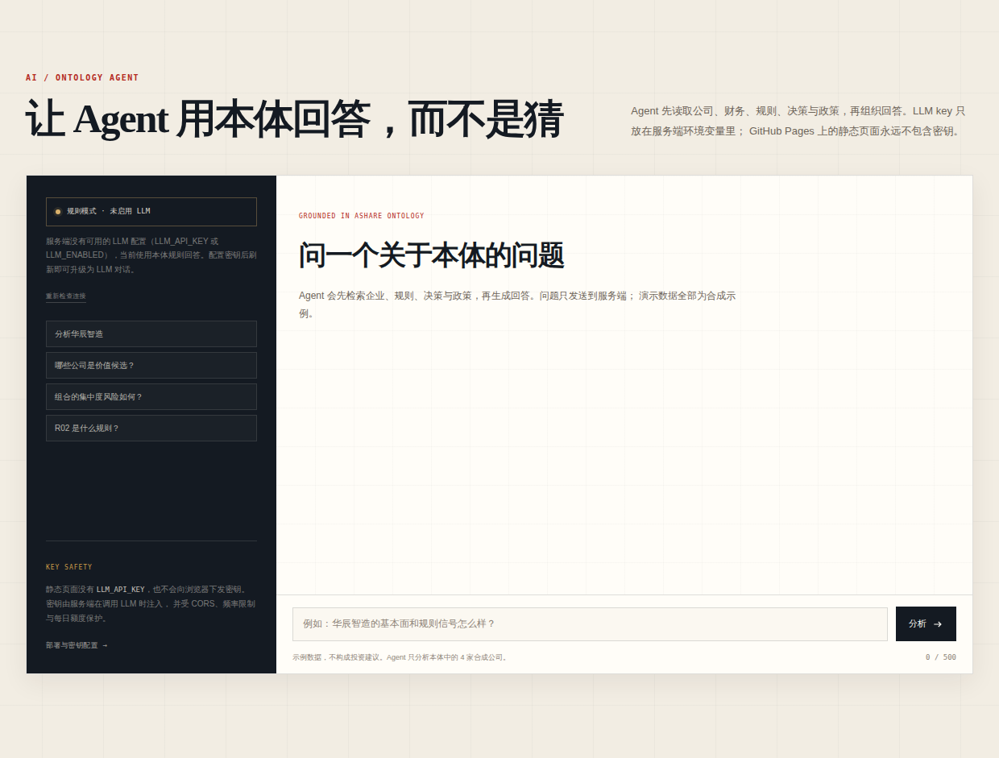
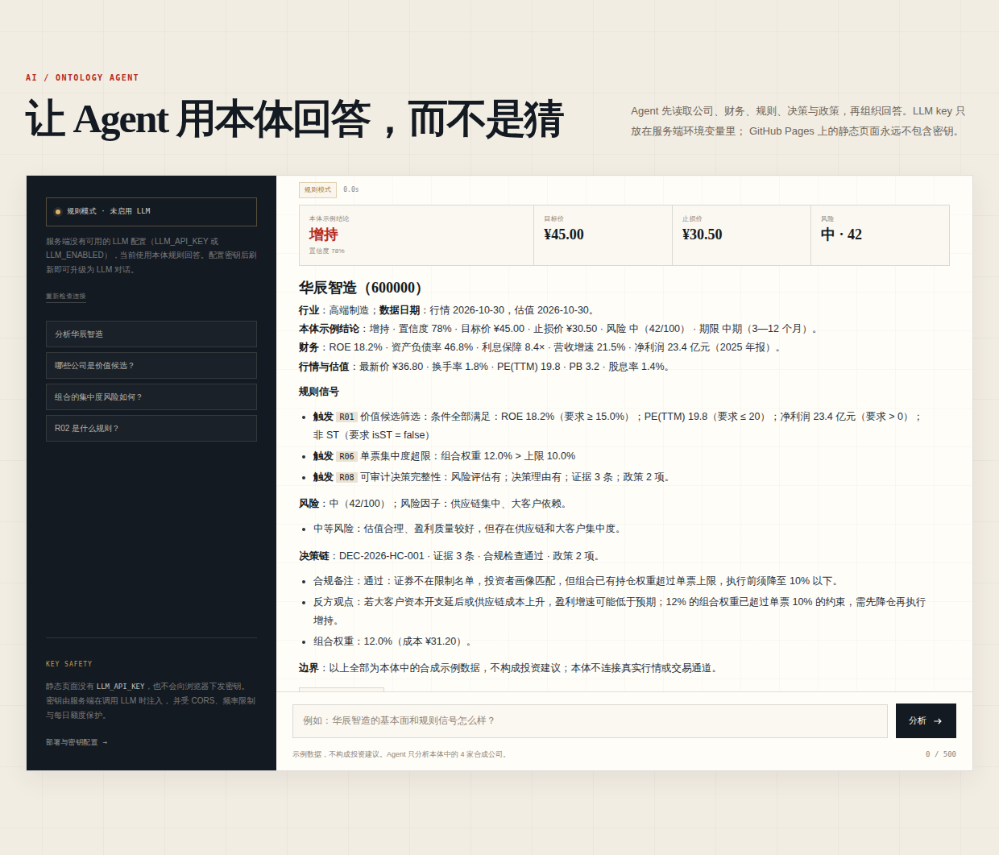

# A 股投资决策本体 · A-Share Investment Decision Ontology

> 一套覆盖 **RDF、RDFS、OWL 2、SKOS、SWRL、OWL-S、ODRL** 的模块化语义模型，
> 用来表达“从数据到投资决策”的可推理、可追溯、可治理链路。

[](docs/evidence/after.png)

页面不是静态说明书：它由本体源文件生成，支持全文检索、按层筛选、类/属性/个体详情、SKOS 概念树、
SWRL 规则卡片、OWL-S 流程和 ODRL 政策矩阵。

---

## 1. 这是什么

A 股投资决策涉及至少八类语义问题：

| 问题 | 语义层 | 本项目回答方式 |
| --- | --- | --- |
| 数据如何表达？ | RDF | 公司、证券、行情、财报、风险、决策、组合的实例三元组 |
| 词汇如何定义？ | RDFS | 类层次、属性 domain/range、双语标签与自然语言定义 |
| 结构约束如何成立？ | OWL 2 | 基数、存在/全称限制、属性特征、键、类不相交 |
| 分类如何组织？ | SKOS | 行业、主题、风格三套 ConceptScheme |
| 决策如何推理？ | SWRL | 11 条无副作用 Horn 规则，覆盖筛选、风险、止损、集中度与合规 |
| 服务如何调用？ | OWL-S | Profile / Process Model / Grounding 三视角的七步决策服务 |
| 政策如何治理？ | ODRL | 权限、禁止、义务、约束、冲突策略与 profile 扩展 |
| 如何把语义链变成可对话分析？ | Agent | 服务端只读工具 + 本体规则 + 可选 LLM，回答带可追溯证据 |

设计参考 **FIBO**（Financial Industry Business Ontology）的模块化、定义优先、可追溯与 OWL 2
建模思路；领域内容为独立编写，**不复用 FIBO 本体文本，也不声称是 FIBO 的官方扩展**。

---

## 2. 快速开始

### 浏览页面

```bash
python3 -m http.server 8000
# 打开 http://127.0.0.1:8000/
```

浏览页面不需要构建、不需要外部 CDN，也不需要后端。`index.html` 直接加载
`assets/js/data.js`（由本体生成的数据快照）。

### 运行 Agent

Agent 需要一个小型服务端；LLM key 只放在服务端环境变量里，GitHub Pages 永远不会收到它。

```bash
make setup          # 创建 .venv 并安装依赖
cp .env.example .env
# 编辑 .env，填入 LLM_API_KEY；不填也能运行规则模式
make agent          # 打开 http://127.0.0.1:8000/#agent
```

没有 key 时 Agent 使用本体规则模式；配置 key 后自动切换为 LLM 对话。部署、密钥配置和
GitHub Pages 接入方式见 [`docs/agent.md`](docs/agent.md)。

### 校验本体

```bash
python3 -m venv .venv
. .venv/bin/activate
pip install -r requirements.txt
python3 scripts/validate.py
```

当前校验结果：

```text
A-share ontology validation passed.
  modules: 7
  triples: 4290
  classes: 72
  object properties: 46
  data properties: 75
  SKOS concepts: 52
  SWRL rules: 11
  OWL-S services: 1
  ODRL policies: 3
  OWL RL closure: 2887 -> 7991 triples (5104 inferred)
  warnings: 0
```

### 重新生成页面数据

```bash
python3 scripts/build_data.py
```

会生成：

- `assets/js/data.js`：浏览器加载的数据快照；
- `assets/data/ontology.json`：同一份数据的 JSON 版本，便于外部消费。

> 页面数据是派生产物。修改本体后必须重新运行 `build_data.py`；不要手工编辑 `data.js`。

---

## 3. 目录结构

```text
.
├── index.html                         # 本体浏览页面 + Agent 对话区
├── assets/
│   ├── css/style.css                  # 页面样式
│   ├── js/app.js                      # 检索、筛选、详情、概念树、规则/服务/政策渲染
│   ├── js/agent.js                    # Agent 前端：只调用公开 API，不含密钥
│   ├── js/agent-config.js             # 公开后端地址；绝不放密钥
│   ├── js/data.js                     # 由 build_data.py 生成
│   └── data/ontology.json             # 由 build_data.py 生成
├── server/                            # Agent 服务端（FastAPI）
│   ├── app.py                         # API、CORS、限流、静态白名单
│   ├── agent.py                       # LLM 工具循环 + 规则模式回退
│   ├── ontology.py                    # 读取 Turtle、构建企业/组合事实
│   ├── rules.py                       # SWRL 阈值与确定性信号评估
│   ├── tools.py                       # 7 个只读本体工具
│   ├── llm.py                         # OpenAI-compatible 客户端（密钥只在服务端）
│   └── settings.py                    # 环境变量配置
├── tests/                             # 服务端、规则与密钥测试
│   ├── test_api.py
│   ├── test_llm.py
│   ├── test_rules.py
│   └── test_secrets.py
├── ontology/
│   ├── a-share.ttl                    # 聚合入口，owl:imports 七层
│   ├── rdf/instances.ttl              # RDF 实例层
│   ├── rdfs/schema.ttl                # RDFS 词汇层
│   ├── owl/ontology.ttl               # OWL 2 公理层
│   ├── skos/taxonomy.ttl              # SKOS 行业/主题/风格
│   ├── swrl/rules.ttl                 # SWRL 规则
│   ├── owl-s/service.ttl              # OWL-S 服务
│   └── odrl/policies.ttl              # ODRL 政策
├── docs/
│   ├── design.md                      # 详细设计说明
│   ├── agent.md                       # Agent 部署、密钥与安全边界
│   ├── competency-questions.rq        # 10 条 SPARQL 能力问题
│   └── evidence/                      # 浏览器前后对比截图
├── scripts/
│   ├── build_data.py                  # Turtle -> 页面 JSON
│   ├── check_no_secrets.py            # 扫描被 git 跟踪文件中的疑似密钥
│   └── validate.py                    # 结构、规则、服务、政策与查询校验
├── Dockerfile                         # 后端容器镜像
├── render.yaml                        # Render Blueprint（密钥用平台 Secret）
├── .env.example                       # 服务端配置模板（不含真实密钥）
└── requirements.txt
```

---

## 4. 七层设计与规范依据

| 层 | W3C 规范 | 本仓库落地 | 关键文件 |
| --- | --- | --- | --- |
| RDF | [RDF 1.1 Concepts](https://www.w3.org/TR/rdf11-concepts/) / [Turtle 1.1](https://www.w3.org/TR/turtle/) | 公司、证券、财报、行情、估值、风险、决策、组合的实例图 | `ontology/rdf/instances.ttl` |
| RDFS | [RDF Schema 1.1](https://www.w3.org/TR/rdf-schema/) | 72 个类、121 个属性，含 `subClassOf`、`domain`、`range`、双语标签 | `ontology/rdfs/schema.ttl` |
| OWL 2 | [OWL 2 Overview](https://www.w3.org/TR/owl2-overview/) / [Structural Specification](https://www.w3.org/TR/owl2-syntax/) / [RDF Mapping](https://www.w3.org/TR/owl2-mapping-to-rdf/) | 38 条类限制、7 个键、6 组类不相交、函数式/传递/对称/逆属性 | `ontology/owl/ontology.ttl` |
| SKOS | [SKOS Reference](https://www.w3.org/TR/skos-reference/) | 3 个 ConceptScheme、52 个概念、层级/关联/多语言标签/定义 | `ontology/skos/taxonomy.ttl` |
| SWRL | [SWRL W3C Member Submission](https://www.w3.org/Submission/SWRL/) | 11 条 `swrl:Imp` 规则，使用 RDF 具体语法与 `swrlb:` 内建 | `ontology/swrl/rules.ttl` |
| OWL-S | [OWL-S 1.2 W3C Member Submission](https://www.w3.org/Submission/OWL-S/) | 1 个 Service、1 个 Profile、1 个 CompositeProcess、7 个 AtomicProcess、7 个 WSDL Grounding | `ontology/owl-s/service.ttl` |
| ODRL | [ODRL Information Model 2.2](https://www.w3.org/TR/odrl-model/) / [Vocabulary 2.2](https://www.w3.org/TR/odrl-vocab/) | 研究数据、决策报告、订单护栏三项政策；含 profile 扩展左操作数 | `ontology/odrl/policies.ttl` |

### 规范状态说明

- RDF、RDFS、OWL 2、SKOS、ODRL 2.2 是 W3C Recommendation；
- **SWRL 与 OWL-S 是 W3C Member Submission，不是 Recommendation**；
- ODRL 的 `humanApproval`、`compliancePassed` 是本项目在 ODRL Profile 中显式声明的扩展左操作数；
- 本项目的“符合规范”指按上述规范构造语法与语义结构，并由结构性校验覆盖；**不是**完整 OWL 2 DL 一致性证明。

---

## 5. 关键建模决策

### 5.1 行业用 SKOS，而不是 OWL 类

行业分类会频繁调整、存在多套标准，且“公司属于某行业”是分类判断而非类成员公理。项目把行业、
主题、风格放进 SKOS，通过 `ash:primaryIndustry` 和 `ash:hasThemeExposure` 关联到 `skos:Concept`。
这样分类可以独立版本化，也能与外部标准做 `skos:closeMatch` 映射，而不污染 OWL 类层次。

### 5.2 决策是“对象”，不是“属性值”

`ash:InvestmentDecision` 是可被引用的实体，绑定：

```text
决策 → 证券 / 公司
     → 投资建议（增持/持有/减持/观察/回避）
     → 理由 → 证据链
     → 风险评估 → 风险等级 / 风险因子
     → 生成服务（OWL-S）
     → 适用画像 / 合规检查
     → ODRL 政策
```

因此“为什么买”不是一段自由文本，而是 `basedOn`、`hasRationale`、`governedBy` 等可查询关系。

### 5.3 规则只做单调推理

SWRL 规则不表达否定、聚合、时间窗口滑移或“缺失即拒绝”；这些属于规则引擎外部的工程逻辑。
当前阈值（15% ROE、20 倍 PE、70% 资产负债率、10% 单票上限等）是**示例常量**，生产环境应外置为
可版本化参数，并保留规则版本、责任人、生效日期和复核日期。

### 5.4 服务与政策是“一等公民”

- OWL-S 把决策服务拆成 7 个可观察步骤，而不是一个不可解释的黑箱；
- ODRL 把数据使用、报告消费和订单执行写成可检查的权限/禁止/义务；
- 服务输出标记 `humanApprovalRequired = true`，不连接任何真实交易通道。

---

## 6. 示例数据

所有公司、证券代码、价格、财务数据、决策和建议均为**合成示例**，仅用于本体、规则与页面演示：

- 华辰智造（600000，示例 A 股）：价值候选、增持、目标价 45.00、止损 30.50；
- 宁源新能源（300000，示例 A 股）：高风险、观察；
- 景康生物（688000，示例 A 股）：临床二元风险、长期观察；
- 示例 ST 公司（600001）：用于演示 ST/退市风险排除。

它们不对应任何真实证券，也不构成投资建议。

---

## 7. 页面能力

- **全文检索**：类、对象属性、数据属性、个体、SKOS 概念、规则、服务、政策；
- **按层筛选**：RDF 实例 / RDFS·OWL / SKOS / SWRL / OWL-S / ODRL；
- **实体详情**：定义、IRI、上下位类、OWL 限制、互不相交类、键、domain/range、属性特征、规则引用、实例事实；
- **SKOS 概念树**：三套方案切换、概念搜索、上下位/关联概念跳转；
- **SWRL 规则卡片**：严重程度筛选、IF/THEN、适用类、读取属性、SWRL 原子展开；
- **OWL-S 服务**：输入、输出、前置条件、七步流程、grounding 操作；
- **ODRL 政策矩阵**：权限、禁止、义务三列，约束与补救措施；
- **决策样例**：建议、目标价、止损、风险、理由、反方观点、证据链与政策；
- **本体 Agent**：自然语言问题 → 服务端本体工具 → 带规则/决策/政策引用的回答；
- **密钥边界**：静态页面不含 LLM key，Agent 通过公开 API 调用独立后端；
- **响应式**：桌面、平板、手机；手机端实体详情为全屏抽屉；
- **浏览页面无外部依赖**：不依赖 CDN、图表库或前端框架；Agent 需要单独部署的服务端。

页面数据由 `scripts/build_data.py` 从 Turtle 生成；本体的规范源始终是 `ontology/**/*.ttl`。

---

## 8. Agent：基于本体的股票分析

[](docs/evidence/agent-section.png)

Agent 不是把整份 Turtle 塞进 prompt。它通过服务端工具按需读取本体：

1. `get_company_analysis`：公司、证券、年报、行情估值、风险、决策、证据、合规与规则信号；
2. `screen_companies`：按 SWRL 规则筛选全部合成公司；
3. `get_portfolio_analysis`：R05 止损与 R06 单票集中度；
4. `get_rule` / `get_policies` / `search_ontology`：规则、ODRL 政策与本体词汇。

LLM 模式由服务端做工具循环；没有 key 或 LLM 调用失败时自动回退到确定性的规则模式。
两种模式使用同一套本体事实和引用，回答里的证据 chip 可以跳回 Explorer 的 IRI 详情。

**密钥边界**：`LLM_API_KEY` 只存在于服务端环境变量；`assets/js/agent-config.js` 只保存公开
的 `apiBase`。`scripts/check_no_secrets.py` 由 `make validate` 运行；CI 也可调用同一脚本。
GitHub Pages 不能运行后端，因此在线 Agent 需要把静态页面接到单独部署的后端；完整步骤见
[`docs/agent.md`](docs/agent.md)。

[](docs/evidence/agent-answer.png)

## 9. 校验覆盖与已知限制

`python3 scripts/validate.py` 覆盖：

- 7 个模块均可解析，聚合入口 `owl:imports` 完整；
- 类与属性具备中文标签、domain/range；
- OWL 限制、键、不相交公理引用已定义术语；
- SKOS 方案、顶层概念、`broader`/`narrower` 互逆；
- SWRL 规则 body/head 非空、变量安全、属性/类存在、内建受支持；
- OWL-S Profile / Process / Grounding 结构完整；
- ODRL 政策含 uid、profile、permission/prohibition、约束三元组；
- 示例决策具备完整决策字段；
- 10 条 SPARQL 能力问题可解析；
- OWL RL 闭包可运行（当前 2887 → 7991 三元组）。

Agent 服务端测试：

```bash
make test          # 服务端测试：API、规则阈值、LLM 客户端、回退与密钥扫描
make validate      # 本体结构校验 + 密钥扫描
```

**限制：**

1. 未内置 OWL 2 DL 完整一致性证明器或 SWRL 推理引擎；规则语义由规范定义，执行需要外部引擎。
2. OWL-S 的 WSDL 端点与操作名均为示意，不指向生产系统。
3. ODRL 是声明式政策；`validate.py` 检查结构，不执行政策决策或访问控制。
4. 示例阈值与数据为合成数据，不能用于真实投资决策。
5. 行业分类是演示结构，不是官方申万/证监会分类的完整复刻。

---

## 10. 设计参考：FIBO 给了什么启发

FIBO 是 EDM Council 维护的金融行业本体，采用模块化领域架构、OWL 2、规范化标签与定义，并强调
可追溯和可演进。本项目借鉴的是**方法**：

- 按领域边界拆分模块，而不是写一个巨型 Turtle 文件；
- 每个类和属性都有自然语言定义和稳定 IRI；
- 分类（SKOS）与结构性知识（OWL）分离；
- 规则、服务、政策各自有版本、责任人和生效日期；
- 决策绑定证据、规则和服务，而不是只保留结论。

FIBO 资料：<https://spec.edmcouncil.org/fibo/> · <https://www.omg.org/spec/EDMC-FIBO/>

---

## 11. 进一步阅读

- [详细设计说明](docs/design.md)
- [Agent 部署与密钥配置](docs/agent.md)
- [10 条 SPARQL 能力问题](docs/competency-questions.rq)
- [聚合入口 ontology/a-share.ttl](ontology/a-share.ttl)
- [浏览器页面 index.html](index.html)

---

## 免责声明

本项目是本体设计与语义 Web 工程示例，不构成投资建议、投资顾问服务或交易系统。页面中的公司、
证券、价格、财务数据、规则阈值、政策与决策均为合成示例。任何将本项目用于真实投资、合规或
生产决策的行为，均需自行完成数据授权、模型验证、适当性管理、合规审查与人工审批。
